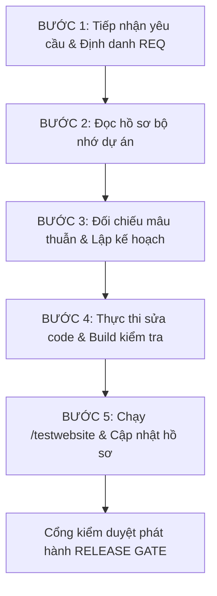

# QUY TRÌNH QUẢN LÝ DỰ ÁN DÀNH CHO AI (AI PROJECT PROTOCOL)

## 1. MỤC TIÊU & NGUYÊN TẮC CỐT LÕI
1. **Lưu trữ bền vững**: Mọi yêu cầu của người dùng, phân tích kỹ thuật, quyết định kiến trúc và kết quả kiểm thử bắt buộc phải được lưu vào các tệp markdown trong repository (`docs/`), không được chỉ tồn tại trong ngữ cảnh trò chuyện tạm thời.
2. **Quy trình bắt buộc trước khi code**: Tuyệt đối không được vội vã viết code khi chưa đọc hồ sơ bộ nhớ dự án và chưa xác minh mâu thuẫn với các quyết định đã có.
3. **Đối chiếu và kiểm thử trước khi bàn giao**: Mọi thay đổi phải đi qua lệnh `/testwebsite` (hoặc `npm run testwebsite`), đối chiếu từng mã yêu cầu `REQ-xxx` với ca kiểm thử `TC-xxx` và có bằng chứng cụ thể trước khi tuyên bố hoàn thành.

---

## 2. QUY TRÌNH 5 BƯỚC BẮT BUỘC KHI NHẬN YÊU CẦU MỚI

### BƯỚC 1: Tiếp Nhận & Phân Loại Yêu Cầu
- Trích xuất nội dung yêu cầu của người dùng từ prompt.
- Phân loại: Tính năng mới / Sửa lỗi hiển thị / Tối ưu hiệu năng / Thay đổi thông số giao diện.
- Gán mã yêu cầu định danh duy nhất (ví dụ: `REQ-001`, `REQ-002`...).

### BƯỚC 2: Đọc Hồ Sơ Bộ Nhớ Dự Án (Bắt buộc)
Trước khi đưa ra giải pháp hoặc viết bất kỳ dòng mã nào, AI phải đọc:
- `docs/PROJECT.md`: Nắm bắt kiến trúc tổng quan, các component liên quan.
- `docs/REQUIREMENTS.md`: Nắm bắt các yêu cầu cũ và tiêu chí nghiệm thu hiện hành.
- `docs/DECISIONS.md`: Nắm bắt các quyết định kỹ thuật đã chốt và các phương án đã bị từ chối/cấm kỵ.
- `docs/HANDOFF.md`: Nắm bắt commit mới nhất và tiến độ hiện tại.

### BƯỚC 3: Đối Chiếu Mâu Thuẫn & Lập Kế Hoạch
- Kiểm tra xem yêu cầu mới có mâu thuẫn với bất kỳ quyết định nào trong `DECISIONS.md` hoặc `REQUIREMENTS.md` hay không.
- Nếu có mâu thuẫn: Phải làm rõ phạm vi thay thế trước khi sửa, ghi nhận vào `DECISIONS.md`.
- Lập kế hoạch chi tiết các file cần tác động và các ca kiểm thử liên quan (`TC-xxx`).

### BƯỚC 4: Thực Thi Sửa Code & Build Kiểm Tra
- Thực hiện sửa mã nguồn với phạm vi tối thiểu, sạch sẽ, không làm hỏng tính năng cũ (hồi quy).
- Giữ nguyên các chú thích code hiện có.
- Chạy lệnh build kiểm tra: `npm run build` đảm bảo 0 lỗi biên dịch.

### BƯỚC 5: Kiểm Thử Toàn Diện & Cập Nhật Hồ Sơ
- Chạy kiểm thử tự động toàn diện qua lệnh `/testwebsite` (hoặc `npm run testwebsite`).
- Kiểm tra kết quả thực tế trên giao diện, thu thập bằng chứng kiểm thử (logs, DOM elements, network status).
- Cập nhật đồng bộ các tài liệu trong `docs/`:
  + `docs/REQUIREMENTS.md`: Ghi nhận mã `REQ-xxx` mới, trạng thái và tiêu chuẩn nghiệm thu.
  + `docs/DECISIONS.md`: Ghi nhận lý do kỹ thuật và các phương án loại trừ.
  + `docs/qa/TEST_PLAN.md`: Cập nhật mã `TC-xxx` tương ứng.
  + `docs/HANDOFF.md`: Ghi nhận commit hash mới và việc tiếp theo.

---

## 3. CƠ CHẾ HOẠT ĐỘNG CỦA LỆNH `/testwebsite`
Khi người dùng gõ lệnh `/testwebsite` (hoặc khi AI thực hiện kiểm thử tự động trước khi bàn giao):
1. **Kiểm tra tính vẹn toàn bộ nhớ (Memory Registry Integrity)**:
   - Xác nhận sự tồn tại và tính hợp lệ của toàn bộ hồ sơ: `PROJECT.md`, `REQUIREMENTS.md`, `DECISIONS.md`, `HANDOFF.md`, `TEST_PLAN.md`, `RELEASE_GATE.md`.
2. **Kiểm tra tính tương thích mã nguồn (Source Code & Flow Assertion)**:
   - Xác thực 97 video Shorts từ 10 kênh chính thống, không có video lỗi 404, không có video nội bộ MP4 giả lập.
   - Xác thực danh sách phát không bao giờ bị rỗng (Empty Playlist Prevention).
   - Xác thực giao diện đáp ứng (Mobile Header không bị đè nút; Tablet cân đối; PC 16:9 toàn cảnh).
   - Xác thực bóc tách tác giả bài viết: Ảnh tác giả là logo avatar tròn nhỏ dưới tiêu đề, không phóng to thành ảnh bài viết, không để tên tác giả mồ côi.
   - Xác thực bố cục Desktop: `padding-top: 10px`, `padding-left: 0px`, `padding-right: 0px`, dải danh mục tin tức `max-w-[872px]`.
3. **Kiểm tra Build & Đóng Gói (Build & Artifact Verification)**:
   - Kiểm tra `npm run build` hoàn thành với mã thoát 0.
4. **Xuất Báo Cáo Kiểm Duyệt Phát Hành (QA Release Audit Report)**:
   - Hiển thị bảng tổng hợp kết quả chi tiết từng ca `TC-xxx` kèm bằng chứng thực tế và trạng thái PASS/FAIL.
   - Nếu có ca FAIL: Lập tức chặn bàn giao và tự động chuyển sang luồng sửa lỗi.

---

## 4. TIÊU CHÍ QUA CỔNG KIỂM DUYỆT (RELEASE GATE)
Không được tuyên bố hoàn thành hoặc bàn giao phiên bản nếu:
1. Còn bất kỳ ca kiểm thử nào trong `TEST_PLAN.md` bị FAIL.
2. Chưa cập nhật hồ sơ bộ nhớ dự án (`HANDOFF.md`, `REQUIREMENTS.md`, `DECISIONS.md`).
3. Lệnh `npm run build` phát sinh lỗi hoặc cảnh báo nghiêm trọng.
4. Có sự suy đoán kết quả mà không có bằng chứng chạy thực tế.
